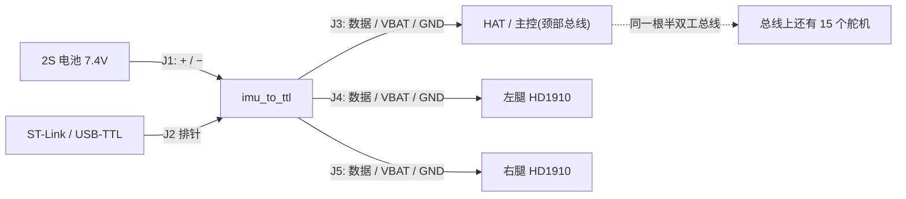

# 接线与装配(新手向)

这块板只干一件事:**把自己伪装成一个舵机**。它挂在和 15 个 HD1910 同一条半双工总线上,
主控读它就像读一个舵机(ID 由固件定),读回来的是 IMU 的姿态四元数。
另外它把电池的电分给**左右腿**的舵机,并顺路把电池送上脖子(去 HAT / 主控)。


---

## 1. 先认清 5 个接口

| 位号 | 是什么 | 线序(从丝印/板边数起) |
|---|---|---|
| **J1** | 电池进线,**裸焊盘直接焊接**(18AWG 穿孔锡焊),左缘竖排(v3.5) | **pin1 = VBAT(+),上** / **pin2 = GND(−),下**(以丝印 +/− 为准) |
| **J2** | 调试排针 1×7(2.54 mm) | GND / SWCLK / SWDIO / UART1_TX / UART1_RX / +3V3 / **NRST** |
| **J3** | 脖子(去 HAT / 主控) | **pin1 = 总线上数据** / pin2 = VBAT / pin3 = GND |
| **J4** | 左腿舵机 | pin1 = 总线数据 / pin2 = VBAT / pin3 = GND |
| **J5** | 右腿舵机 | pin1 = 总线数据 / pin2 = VBAT / pin3 = GND |

### 1.1 三个舵机口的线序 —— 这条最要命

**HD-1910(飞特)是 `1=Signal / 2=Vcc / 3=GND`**;
而 Dynamixel XL330 是 `1=GND / 3=Signal`(反的)。本板按 **HD-1910** 做的,
**不能拿 XL330 的线序直接插**。插反的后果是电直接灌进信号脚。

> 出处:OpenMicroDuck 项目文档 `docs/servo.md`("HD-1910 是 1=Signal / 3=GND,与 Dynamixel 和 HL-2915 的 1=GND / 3=Signal 相反")。
> 这条**务必在实物上再确认一次**:拿一个 HD1910,看它插头上哪根是正极(通常红/橙 = Vcc),
> 用万用表确认后再插本板。厂家的规格书只给了外形图,没画线序。

### 1.2 如果你用的是官方 HAT

官方 HAT 是按 **Dynamixel 线序**画的。J3 是直通,所以:

- HAT 一侧也是 HD-1910 线序 → 按本板丝印插即可;
- HAT 一侧是 XL330 线序 → **必须做一根交叉转接线**(1↔3 对调),否则数据脚会挨电池电压。

## 2. 怎么连



要点:

- **总线上所有设备并联**:主控、15 个舵机、本板,全是同一根数据线(加地)。
- **电池正极先经过本板的 F1(5 A 保险丝)** 再分发出去。所以本板同时是配电点。
- 左右腿舵机的电走 J4/J5;脖子那截走 J3。
- **限制在接口和保险丝,不在板子铜箔了**(2026-09-16 加固过):
  - 整板总电流:**≤3.5 A**(F1 是 5 A 快速保险丝,长期用要降额)
  - 每个舵机口:**≤2 A**(JST PH 每针额定 2 A)
  - 板内电池路径**由 63.3 mm² 的 VBAT_RAW 顶层铺铜承担**,最窄走线 0.4 mm 只出现在短段
  - **反接保护 PMOS(AO4407C)** 手册 Rds(on) ≤18.5 mΩ → 3.5 A 时 0.23 W,**结温只 +17 °C** ✓
  - 所以:**铜箔和 MOS 都不是限制** ✓
  - 结论不变:每口只带自己那条腿的舵机,别把 15 个舵机全串在这块板后面

### 2.1 电流账(HD-1910 规格书数据)

| 状态 | 单个舵机 | 说明 |
|---|---|---|
| 静止 | 20 mA | |
| 空载转 | ≤210 mA | |
| 额定负载 | 500~900 mA | 正常走路大概在这一档 |
| **堵转** | **1.2~2 A** | 只应出现在碰撞/卡住时 |

按每腿 2 个舵机算,J4/J5 平时不到 2 A(够用),但**两个同时堵转就超了** ——
这也是为什么 F1 选 5 A、并且强烈建议在固件里打开舵机自身的过载保护。

> ⚠️ **飞特舵机的过流/过压保护出厂默认是关闭的**(只有过热保护默认开启)。
> 也就是说:**不主动打开,堵转时没有任何东西在保护 PH 接口** —— PH2.0 每针额定 2 A,
> 而两个舵机同时堵转是 2.4~4 A,5 A 的保险丝救不了它。开启方法见舵机协议手册的内存表。

## 3. 第一次上电(按顺序来)

1. **别接舵机、别接 HAT**。只接电池到 J1。
2. 用限流电源最好(8.4 V / 100 mA);用电池也行,但手别离开插头。
3. 上电后 **约 10 毫秒** 才建立 3.3 V —— 板上 Q1 是软启动(限制插入电池时的冲击电流),**这是正常的**,基本感觉不到。
4. 看 LED1 亮、摸板子不烫。万用表量 TP3(+3V3)应为 3.3 V。
5. 一切正常后,再依次接 J3(HAT)、J4/J5(腿舵机)。
6. 完整验收按 `docs/首板验收清单.md` 走一遍。

**千万别做的**:不确认极性别把电池怼进 J1(pin1 是正);不要在总线上带电插拔舵机。

## 4. 烧固件

固件在 `firmware/`,`make` 出来的是 `firmware/build/imu_to_ttl.elf`。
本板没有板载调试器,用 **ST-Link + J2** 的 SWD 排针:

```
J2: 1=GND  2=SWCLK  3=SWDIO  4=UART1_TX  5=UART1_RX  6=+3V3  7=NRST
ST-Link: GND → 1, SWCLK → 2, SWDIO → 3, 3.3V → 6(可不接,板子自己供电)
```

OpenOCD(本机没装,需先 `pacman -S openocd`):

```sh
openocd -f interface/stlink.cfg -f target/stm32g0x.cfg \
        -c "program firmware/build/imu_to_ttl.elf verify reset exit"
```

J2 上还引出了 **UART1_TX/RX** 和 **NRST**:前者接 USB-TTL 可以直接看调试打印(3.3 V 电平,
别接 5 V 的),后者短一下就是复位键。

## 5. 常见坑

| 现象 | 大概率原因 |
|---|---|
| 上电后约 10 ms 才有 3.3 V | 正常,软启动(限冲击电流) |
| 主控读到本板自己发的命令 | 正常。本板的收线就是总线,固件按发送长度丢回显(见 `docs/首板验收清单.md` 2.5) |
| 舵机不动、CPU 还能通信 | 总线线序/接插件;先按 1.1 复查线序 |
| 通信一接长线就出错 | 上拉偏弱。补焊 **R11(4.7 k,ALT 位)** 与 R8 并联(约 1.5 k)加强上拉 |
| 姿态数据有大台阶而不是缓慢漂移 | IMU 的机械应力,不是芯片坏 —— 查固定方式与 U2 焊接 |
| 电池插上没反应 | 先量 F1 通断(它是一次性保险丝,选 5 A) |

## 5.1 本板(v3.6)必做的一步:U2 飞线 ⚠️

这块板的 IMU 芯片(U2)第 6/7 脚(地)在设计生成时被电源线围死,板上无法布线
连到主地(已数学验证)。**所以板上留了一个专门的焊盘 TG1**(U2 左下方,丝印
圈内的 0.8mm 圆焊盘)。

**装配步骤:焊好 U2 之后、上电之前——**
拿一段细导线(漆包线/30AWG),一头焊 U2 第 6 脚(或第 7 脚),另一头焊 TG1,
线长约 2mm,从 VBAT_RAW 走线上方跨过即可(线有绝缘漆,不导通处无影响;
用裸线则确保只搭这两点)。

**不飞这根线,IMU 完全不工作**(芯片没有地)。飞好线后用万用表量:
U2.6 脚与 J1 的 GND 端子应导通。
